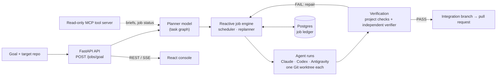

# Hermes Runtime

Hermes runs a team of coding agents (Claude Code, Codex, Antigravity) on one engineering goal and
only lets their work through after it has been verified. You give it a goal and a Git repository.
A planner model splits the goal into a task graph. Each task runs in its own Git worktree, an
independent agent and the project's own checks verify it, and a passing job ends in a pull request.

## Why

Coding agents write code quickly, but on their own they cannot be trusted with a repository: they
drift from the goal, mark their own work as done, and lose state when a process dies. Hermes is the
harness around them:

- **Planning:** a planner model turns a goal into tasks with roles and dependencies, and the runtime assigns agents by capability.
- **Isolation:** every agent works in its own worktree; only verified work is merged into the job's integration branch.
- **Verification:** the project's declared checks run outside any agent sandbox. A verifier agent that did not build the work reports PASS, FAIL or UNPROVEN, and a failure triggers a bounded repair cycle.
- **Durability:** the job ledger lives in Postgres. After a restart, unfinished jobs resume on their own, and a provider usage limit pauses a job instead of failing it.
- **Operator view:** a React console streams jobs, tasks, agents and events over REST/SSE.

## Architecture



The orchestrator agent gets its tools from a read-only MCP (stdio) server
([`orchestrator/tools_server.py`](orchestrator/tools_server.py)). It can read the project briefs in
LysStack and the job and capacity status in Hermes, but it cannot start, cancel or merge a run. The full
design is in [`architecture.md`](architecture.md).

## Quick start

Requires Python 3.12, Docker, Git, and the agent CLIs you want to run (`claude`, `codex`, `agy`).

```bash
python -m venv .venv && .venv/bin/pip install -r requirements.txt
.venv/bin/python -m pytest -q                 # 1019 tests

docker compose up -d postgres                 # optional: durable job ledger
.venv/bin/alembic upgrade head
.venv/bin/uvicorn main:app --port 8000
```

Dry-run a goal job first to check the plan without running any agent:

```bash
curl -X POST localhost:8000/jobs/goal -H 'content-type: application/json' -d '{
  "goal": "Add a /health endpoint with a test",
  "targetRepo": "my-service",
  "dryRun": true
}'
curl localhost:8000/jobs/<job_id>/tasks
```

`targetRepo` must be a Git repository directly under `HERMES_GOAL_REPOS_ROOT` (default `~/Projects`).
A project can declare its checks in a `hermes.json` at its root
(`{"checks": [{"name": "check", "command": "./scripts/check", "timeout_seconds": 900}]}`). Hermes runs
them before each verification and again at the final gate.

Console: `cd console && npm ci && VITE_LYSSTACK_API_URL=http://localhost:8000 npm run dev` (see
[`console/README.md`](console/README.md)).

## Key capabilities

- **Multi-agent orchestration:** pluggable agent adapters ([`Antigravity`](runner/agents/antigravity.py), [`Claude`](runner/agents/claude.py), [`Codex`](runner/agents/codex.py)) running isolated phases across dedicated Git worktrees.
- **Execution backends:** a `subprocess` runtime alongside one-shot and sessionful `herdr` agent lifecycle backends.
- **External repositories:** the Hermes control root (`control_root`) is kept separate from target repositories (`target_repo`).
- **Generic verification:** a declarative, ordered verification pipeline for any test suite (Playwright E2E, pytest, uv, npm) with per-step timeouts and working directories, and sanitized reports.

## Tests

`python -m pytest -q` runs the whole suite (1019 passed, 6 skipped on 2026-10-29). GitHub Actions runs it on
every push and pull request. Postgres tests use a separate `hermes_lab_test` database.

## Compatibility Names

`LYSSTACK_CONTROL_URL` and the `LYSSTACK_*` agent-message markers are retained
for existing runner configurations and prompt protocols. They refer to Hermes
Runtime APIs and messages, not a separate LysStack execution service.

## Durable Jobs

Without `DATABASE_URL`, Hermes keeps its job ledger in memory and a restart loses every running job. With it, a restart resumes unfinished goal-planned jobs on its own:

```bash
docker compose up -d postgres                       # container hermes_postgres
.venv/bin/alembic upgrade head                      # creates the tables in hermes_lab
```

The `lysomarchy-hermes-api` service reads `DATABASE_URL` from `~/.config/lysomarchy/hermes-stack.env`. Live jobs use the `hermes_lab` database; the Postgres tests use a separate `hermes_lab_test` database in the same container.

On startup, Hermes waits for the previous process's job lease to expire (up to 60s), then rebuilds each job's agents from the settings it was launched with. Finished tasks are kept, interrupted ones run again from a clean worktree, and a usage limit that hasn't reset yet still pauses the job. A job interrupted while planning is planned again. Set `HERMES_AUTO_RESUME=0` to resume jobs by hand with `POST /jobs/{id}/resume`.

## Worktree Layout

Sprint worktrees are organized per sprint, e.g. under `~/hermes-worktrees/hermes-lab-s03/` or `~/hermes-worktrees/hermes-lab-s04/`:

- `integration/` — Target integration branch receiving validated controller merges
- `antigravity/` / `claude/` / `codex/` — Isolated worker worktrees assigned to respective agent phases

## Verification & Playwright E2E Testing

Target projects can declare an ordered `verification` pipeline in the sprint specification. This enables automated end-to-end testing, including Playwright browser test suites and Node/Python verification steps:

```json
{
  "verification": [
    {
      "name": "install-dependencies",
      "cwd": "frontend",
      "command": ["npm", "ci"]
    },
    {
      "name": "playwright-e2e",
      "cwd": "frontend",
      "command": ["npx", "playwright", "test"],
      "timeout_seconds": 600
    }
  ]
}
```

### Verification Pipeline Features:
- **Direct Argv Execution**: Commands execute directly as argv arrays without shell interpolation or risk of command injection.
- **Per-Step Cwd & Timeout**: Each step can run in a relative subdirectory (e.g. `frontend`, `backend`) with an optional step-level `timeout_seconds`.
- **Fail-Fast Enforcement**: Verification halts on first failure, failing with `FAILED_VERIFICATION` or `FAILED_INVALID_VERIFICATION_SPEC`.
- **Isolated Logging & Sanitization**: Stdout and stderr logs are preserved under `~/hermes-runs/`, while sanitized reports (`--export-report`) strip sensitive runtime metadata and tokens.
- **Backwards Compatibility**: Specs omitting `verification` fall back to the legacy isolated venv / pytest workflow.

## Sprint history

- **Sprint 01**: Initial FastAPI health service scaffolding and endpoint implementation (`/health` and `/version`). Merged into `main`. Old worktrees (`~/hermes-lab-agy` and `~/hermes-lab-claude`) cleaned up.
- **Sprint 02**: Worktrees initialized under `~/hermes-worktrees/hermes-lab-s02/`.
- **Sprint 03**: Agent adapters and first-class Codex worker support.
- **Sprint 04**: Execution backend abstraction with subprocess compatibility and one-shot Herdr hosting.
- **Sprint 05**: Reproducible three-agent delivery with Antigravity scaffolding, Claude hardening, and Codex verification.
- **Sprint 06**: External target repository support, generic multi-command verification pipeline (Playwright / npm / uv / pytest), and Codex-first native Herdr session backend with lifecycle and ownership verification.
