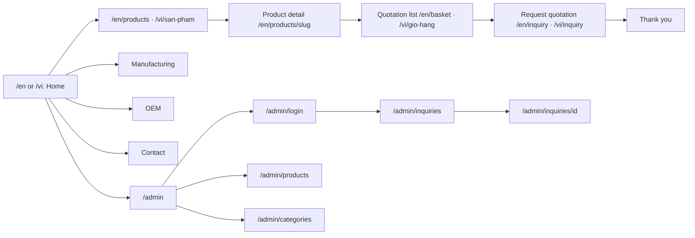
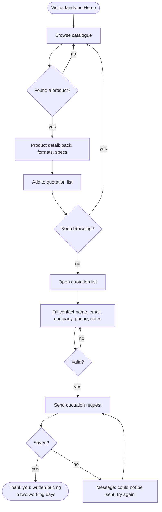
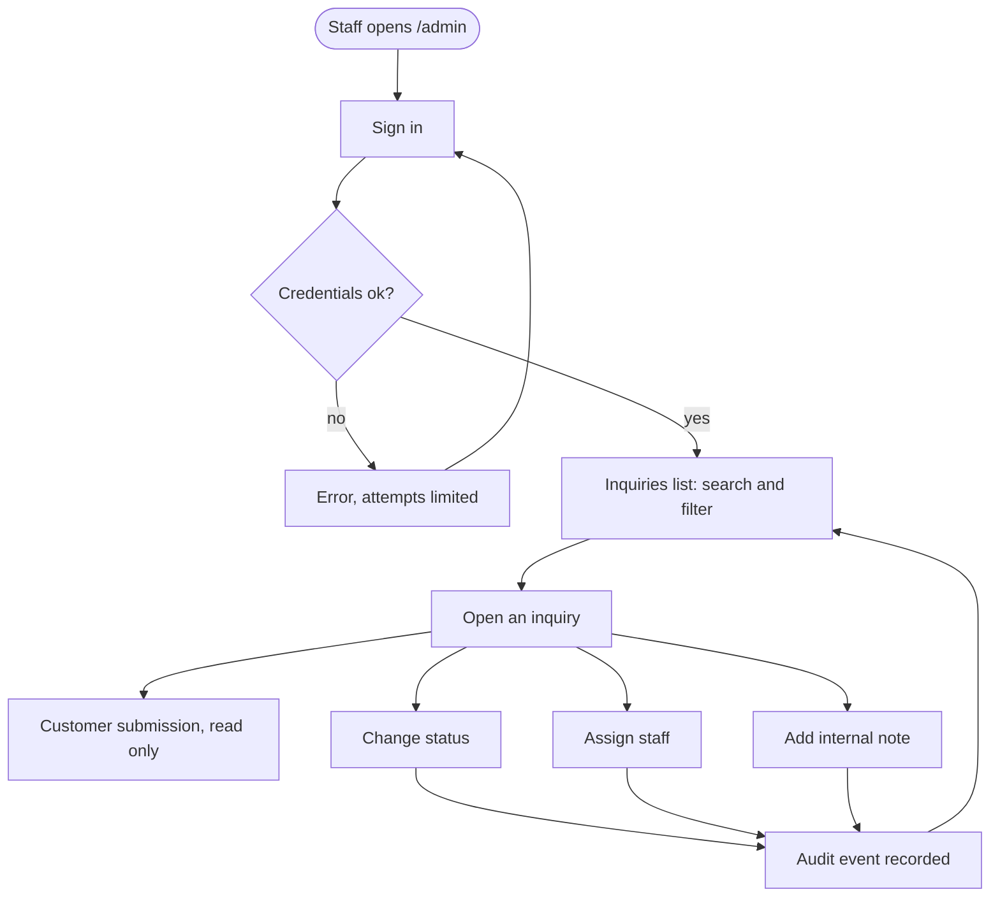
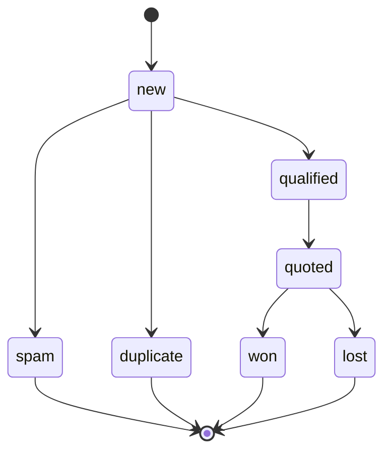
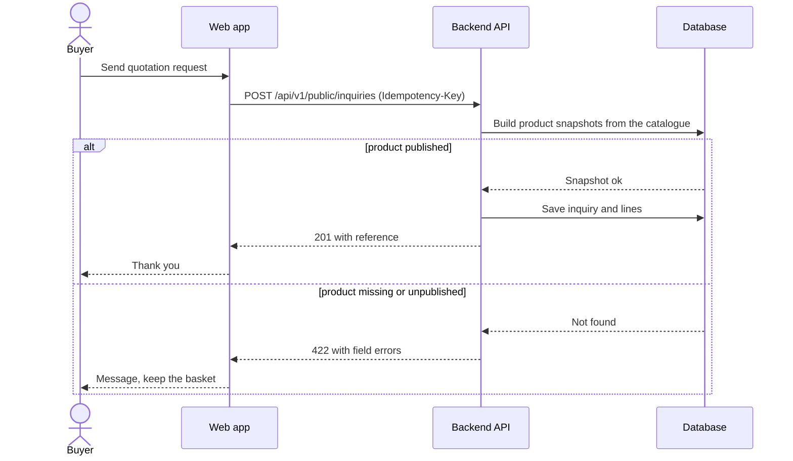
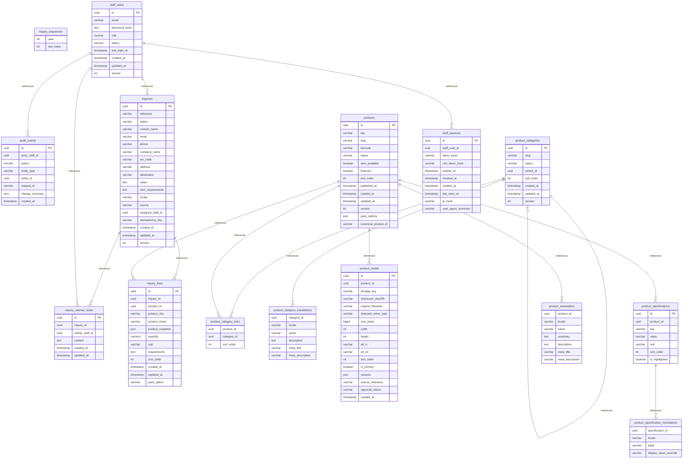

# Unigreen diagrams

Each diagram is Mermaid source. GitHub draws the blocks below. To render one elsewhere,
paste its block into the [Mermaid Live Editor](https://mermaid.live).
Regenerate this page with `python3 build_readme.py` after editing a source in `src/`.

## Sitemap

_status: intended design (not built)_

## Buyer flow: product to quotation request

_status: intended design (not built)_

## Staff flow

_status: intended design (not built)_

## Inquiry status lifecycle

_status: intended design (not built)_

## Submitting an inquiry

_status: intended design (not built)_

## Database (generated from the staging schema)

_status: generated from the Unigreen database schema (staging)_

